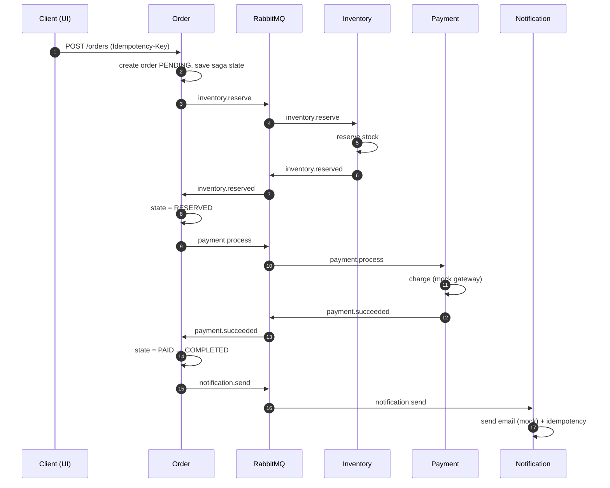
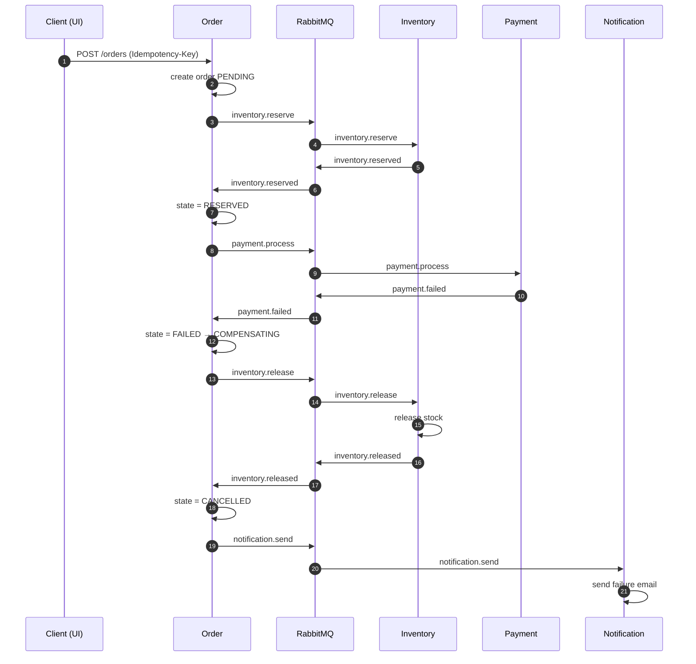

# SAGA (orchestration)

Order Service — оркестратор. Состояния:
`PENDING → RESERVED → PAID → COMPLETED`
либо
`FAILED → COMPENSATING → CANCELLED`.

## Happy path

## Compensation path

## Идемпотентность
- Все мутирующие endpoints принимают `Idempotency-Key`.
- Ключи в Redis (TTL 24 ч) + запись в БД для аудита.
- Повторный запрос с тем же ключом → тот же результат, без повторного списания/резерва.

## Outbox
- Таблица `outbox` в order, inventory, payment.
- Фоновый воркер публикует события в RabbitMQ.
- Гарантия at-least-once; consumer'ы идемпотентны.

## Retry
- `tenacity`, экспоненциальная задержка 1→2→4→8 с, 3–5 попыток.
- Только идемпотентные операции (публикация, чтение, refund).

## DLQ
- Очереди `*.dlq` для сообщений, не обработанных после N попыток.